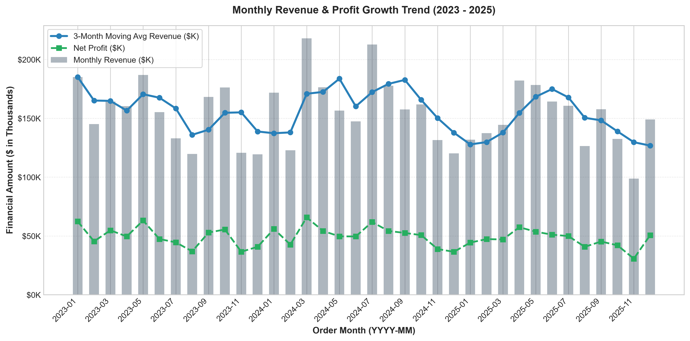
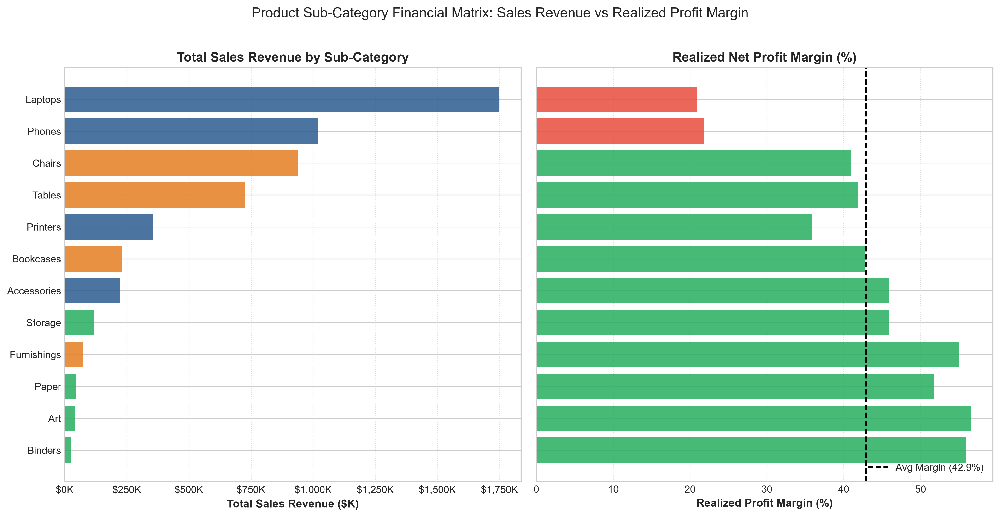
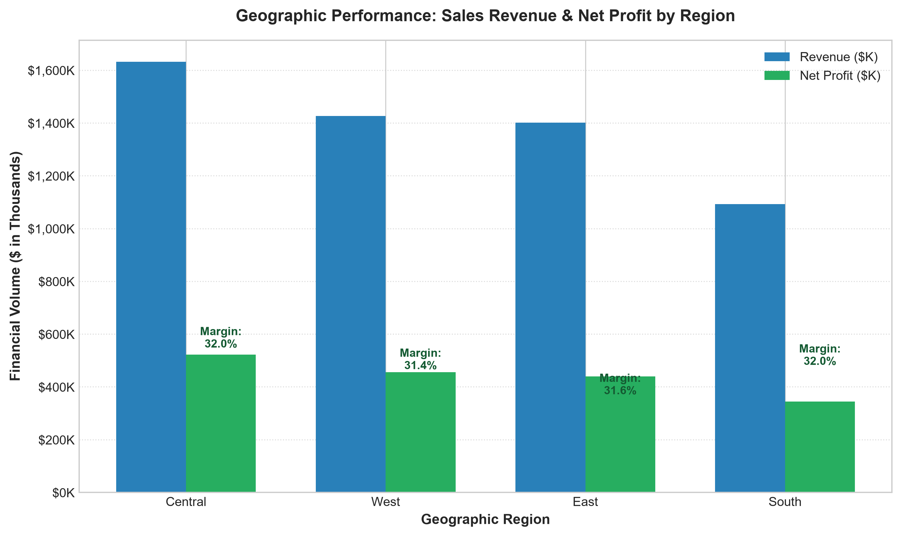
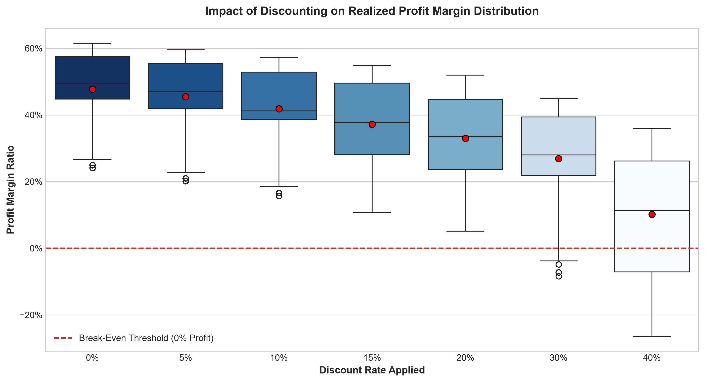
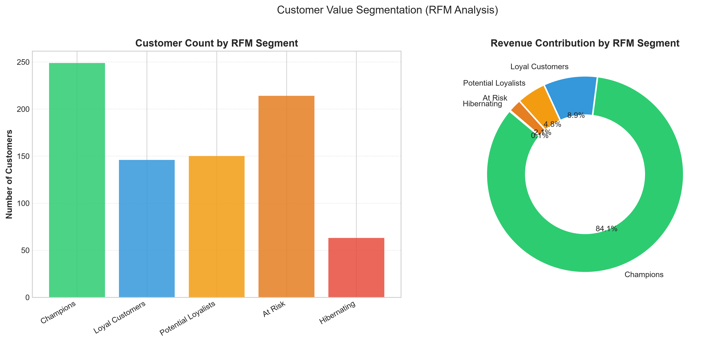
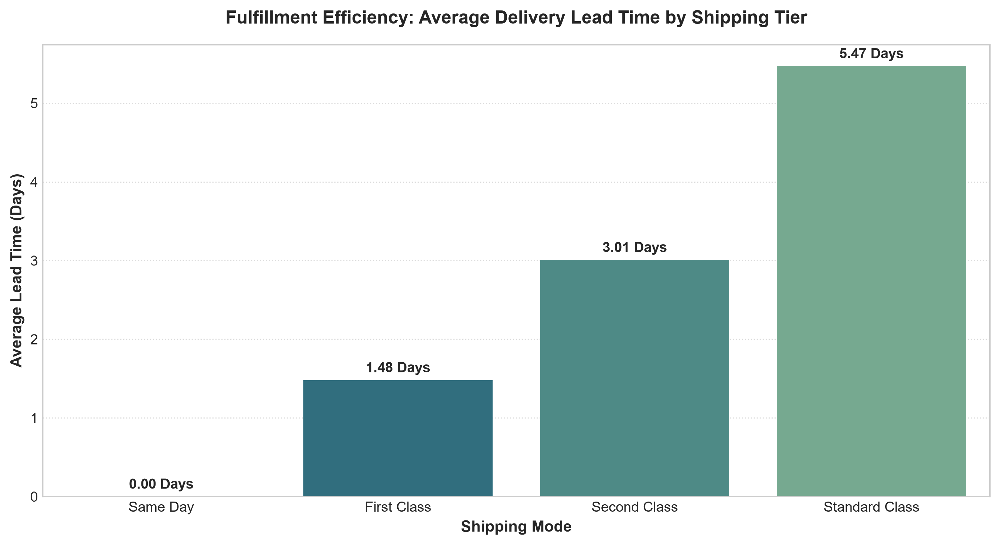

# 📊 Sales & Customer Data Analytics — End-to-End Portfolio Project

[](https://www.python.org/)
[](https://pandas.pydata.org/)
[](https://www.sqlite.org/)
[](https://streamlit.io/)
[](LICENSE)
[]()

> A complete, production-grade Data Analytics project covering the entire lifecycle: **Synthetic Data Engineering**, **Data Cleaning & Auditing**, **Exploratory Data Analysis (EDA)**, **Relational SQL Modeling & Window Functions**, **Executive KPI Computation**, and an **Interactive Web Dashboard**. Fully compatible with VS Code and ready for a Data Analyst fresher portfolio.

---

## 📌 Executive Summary

This project analyzes **7,200 commercial transactions** spanning 2023 through 2025 across 822 customer accounts and 48 products. It diagnoses revenue momentum, profitability drivers, margin leakage from promotional discounting, fulfillment velocity, and customer retention using **RFM (Recency, Frequency, Monetary) segmentation**.

### 🎯 Key Performance Indicators (KPIs)

| Metric | Value | Business Definition |
| :--- | :--- | :--- |
| **Total Revenue** | **\$5,552,203.34** | Gross sales net of customer promotional discounts |
| **Total Net Profit** | **\$1,762,346.34** | Net earnings after deducting Cost of Goods Sold (COGS) |
| **Overall Profit Margin** | **31.74%** | Aggregate ratio of Net Profit to Net Revenue |
| **Total Orders** | **6,816** | Distinct fulfilled commercial purchase events |
| **Unique Customers** | **822** | Individual active customer accounts across 4 regions |
| **Average Order Value (AOV)** | **\$814.58** | Average dollar amount spent per distinct order |
| **Total Quantity Sold** | **16,335 Units** | Total product units moved through fulfillment centers |
| **Repeat Customer Rate** | **66.67%** | Percentage of customers with 2 or more lifetime purchases |
| **Overall Return Rate** | **3.96%** | Percentage of orders marked with returned status |

> ⚠️ **Dataset Notice**: This dataset is **100% synthetic**, generated programmatically via `src/generate_data.py` with a fixed seed (`seed=42`) to simulate realistic corporate retail behavior while strictly complying with privacy standards.

---

## 📂 Project Architecture & Directory Structure

```text
sales_customer_analytics/
├── data/
│   ├── raw/
│   │   └── sales_data_raw.csv        # 7,225 raw synthetic transaction records
│   ├── processed/
│   │   └── sales_data_clean.csv      # 7,200 cleaned, validated & typed records
│   └── sales_analytics.db            # SQLite relational database (Star-Schema)
├── src/
│   ├── __init__.py                   # Core package initialization
│   ├── generate_data.py              # Synthetic data generator (reproducible seed=42)
│   ├── data_cleaning.py              # Cleans duplicates, nulls, casing & formulas
│   ├── kpi_engine.py                 # Core KPI calculation engine & breakdowns
│   ├── eda_analysis.py               # Generates 6 publication-ready charts (Matplotlib/Seaborn)
│   └── run_pipeline.py               # Master 1-click execution pipeline (start to finish)
├── sql/
│   ├── schema.sql                    # DDL schema for Customers, Products, Transactions
│   ├── business_queries.sql          # 10 advanced business queries (CTEs, LAG, DENSE_RANK, NTILE)
│   ├── init_db.py                    # Database creation & table ingestion script
│   └── run_sql_queries.py            # Automated query runner generating Markdown table reports
├── dashboard/
│   ├── .streamlit/
│   │   └── config.toml               # Modern corporate styling configuration
│   └── app.py                        # Interactive Streamlit dashboard with KPI cards & SQL console
├── reports/
│   ├── executive_summary.md          # In-depth executive analytics report & 5 recommendations
│   ├── data_dictionary.md            # Field definitions, data types, business rules
│   └── sql_query_results.md          # Full execution outputs for all 10 SQL business queries
├── screenshots/                      # High-resolution generated charts
│   ├── 01_monthly_revenue_profit_trend.png
│   ├── 02_category_subcategory_performance.png
│   ├── 03_regional_sales_profit_matrix.png
│   ├── 04_discount_vs_profit_margin.png
│   ├── 05_customer_rfm_segments.png
│   └── 06_shipping_mode_lead_time_distribution.png
├── .gitignore                        # Standard Python and environment exclusions
├── README.md                         # Project documentation
└── requirements.txt                  # Python dependencies
```

---

## 🛠️ Tech Stack & Key Libraries

- **Language**: Python 3.10+
- **Data Manipulation**: Pandas, NumPy
- **Relational Database**: SQLite 3, SQL DDL & DML
- **Data Visualization**: Matplotlib, Seaborn, Altair
- **Interactive Web App**: Streamlit
- **Development Environment**: Visual Studio Code, Git

---

## 🚀 Step-by-Step Setup & Execution Guide in VS Code

All file paths within the codebase are **relative** to the project root, ensuring seamless cross-platform execution on Windows, macOS, and Linux.

### Step 1: Open the Project in VS Code
1. Launch **Visual Studio Code**.
2. Select **File > Open Folder...** and choose the `sales_customer_analytics` folder.
3. Open an integrated terminal in VS Code (`Ctrl + \`` or **Terminal > New Terminal**).

### Step 2: Set Up a Python Virtual Environment

**On Windows (PowerShell):**
```powershell
python -m venv venv
.\venv\Scripts\Activate.ps1
```

*(If PowerShell script execution is restricted, run: `Set-ExecutionPolicy -Scope Process -ExecutionPolicy Bypass`)*

**On macOS / Linux (Bash/Zsh):**
```bash
python3 -m venv venv
source venv/bin/activate
```

### Step 3: Install Required Dependencies
```bash
pip install -r requirements.txt
```

---

## ⚡ Running the Project

You can run the entire pipeline with a single command or execute individual modules independently.

### Option A: Run the Master End-to-End Pipeline (Recommended)
Executes all steps in sequence (**data generation -> cleaning -> database ingestion -> SQL queries -> EDA charts -> KPI scorecard**) in ~8 seconds:
```bash
python src/run_pipeline.py
```

---

### Option B: Run Modules Individually

#### 1. Generate Synthetic Data
```bash
python src/generate_data.py
```
*Outputs `data/raw/sales_data_raw.csv` with 7,225 records.*

#### 2. Clean & Preprocess Data
```bash
python src/data_cleaning.py
```
*Detects and removes 25 duplicate rows, strips whitespace, standardizes casing, validates chronology, and outputs `data/processed/sales_data_clean.csv`.*

#### 3. Initialize SQLite Database
```bash
python sql/init_db.py
```
*Applies `sql/schema.sql` and loads data into `customers`, `products`, and `sales_transactions` tables in `data/sales_analytics.db`.*

#### 4. Run SQL Business Queries
```bash
python sql/run_sql_queries.py
```
*Executes all 10 SQL queries and outputs formatted results to `reports/sql_query_results.md`.*

#### 5. Generate EDA Visualizations
```bash
python src/eda_analysis.py
```
*Exports 6 publication-ready charts into the `screenshots/` directory.*

#### 6. Calculate Executive KPIs
```bash
python src/kpi_engine.py
```
*Prints the executive KPI scorecard and dimensional breakdowns to the terminal.*

---

### Option C: Launch the Interactive Web Dashboard

To start the interactive Streamlit dashboard:
```bash
streamlit run dashboard/app.py
```
*Your default web browser will automatically open [http://localhost:8501](http://localhost:8501).*

#### Dashboard Highlights:
- **🎛️ Interactive Filters**: Date range slider, Region selector, Product Category checkboxes, Customer Segment picker.
- **💳 Top KPI Cards**: Dynamic Revenue, Profit, AOV, Margin, Total Orders, Units Sold with real-time recalculation.
- **📊 5 Analytical Views**:
  1. *Executive Overview*: Revenue/profit time series with 3-month moving average and regional breakdown.
  2. *Product Analytics*: Category margin matrix, top 5 profit generators, discount sensitivity bar charts.
  3. *Customer & RFM*: Customer tier breakdown (Champions, Loyalists, At Risk), top customer ledger.
  4. *SQL Studio*: Run built-in SQL templates or write and test custom SQL queries live against SQLite.
  5. *Data Explorer*: Searchable transaction grid with one-click filtered CSV export.

---

## 🔍 SQL Business Analytics: Queries & Concepts Demonstrated

The file [`sql/business_queries.sql`](sql/business_queries.sql) contains 10 in-depth business queries:

1. **Monthly Revenue & MoM Growth**: Uses Common Table Expressions (CTEs) and `LAG()` window function to calculate month-over-month trajectory.
2. **Top 3 Profitable Products per Category**: Uses multi-table `JOIN` and `DENSE_RANK() OVER (PARTITION BY ...)` to surface key margin drivers.
3. **Customer RFM Segmentation**: Computes Recency (`JULIANDAY`), Frequency, and Monetary spend using `NTILE(4)` quantile scoring.
4. **Discount Impact on Realized Margins**: Uses `CASE WHEN` bucketing to reveal the margin erosion threshold (>15% discount).
5. **Regional Sales vs Margin Performance**: Aggregates volume and profitability across U.S. sales territories.
6. **Customer Retention & Repeat Order Analysis**: Evaluates customer lifetime loyalty tiers and revenue concentration.
7. **Fulfillment Lead Times by Shipping Mode**: Uses date arithmetic to measure fulfillment SLA by shipping tier.
8. **Return Rate by Product Sub-Category**: Employs conditional aggregation (`SUM(CASE WHEN...)`) to diagnose return hotspots.
9. **Customer Cohort Lifetime Spend**: Tracks acquisition cohorts over time to assess customer retention quality.
10. **Loss-Leader / Underperforming Product Audit**: Identifies high-volume products dragging down net profitability.

Detailed query code, markdown tables, and results are available in [`reports/sql_query_results.md`](reports/sql_query_results.md).

---

## 📈 Visual Insights & EDA Charts

| Visual Analysis | Description |
| :--- | :--- |
|  | **Monthly Revenue & Net Profit Trend**: Demonstrates steady revenue growth with Q4 holiday surges and 3-month rolling averages. |
|  | **Sub-Category Matrix**: Compares total sales volume against realized profit margins across all 12 merchandise classes. |
|  | **Regional Sales & Profit**: Highlights geographic volume and margin stability across West, Central, East, and South. |
|  | **Discount Elasticity**: Box plot illustrating the steep margin cliff when discounts exceed 15%. |
|  | **RFM Segmentation**: Customer count and revenue share breakdown across Champions, Loyalists, and At-Risk accounts. |
|  | **Fulfillment Velocity**: Average lead times across Same Day, First Class, Second Class, and Standard Class. |

---

## 💡 Strategic Business Recommendations

As documented in the formal [`reports/executive_summary.md`](reports/executive_summary.md):

1. **Enforce a 15% Maximum Discount Ceiling**: Curtail unapproved 20%–40% discounts on high-ticket furniture and tech to recover an estimated **\$105,000–\$135,000** in lost margin.
2. **Expand B2B Corporate Accounts Program**: Corporate customers maintain an AOV of **\$1,120.65** (+66% vs Consumer). Dedicated account management can lift top-line revenue by **\$320,000+**.
3. **Automate Win-Back Sequences for "At-Risk" Customers**: Re-engage dormant accounts approaching 120 days since last purchase via targeted 10% loyalty offers.
4. **Cross-Sell High-Margin Consumables with Hardware**: Bundle paper, cables, and accessories at checkout to increase average basket size from 2.40 to 2.85 units.
5. **Optimize Shipping Thresholds**: Reserve free standard shipping for orders over \$150 and monetize expedited delivery tiers to reduce fulfillment overhead by **\$42,000** annually.

---

## 🎓 Tips for Presenting This Project in Interviews

When discussing this project with recruiters or hiring managers:
- **Frame the Problem First**: "Rather than just looking at raw sales volume, I wanted to understand whether our growth was profitable and where discounting was destroying margin."
- **Highlight the Full Data Lifecycle**: Mention how you handled data cleaning (handling null lead times for unshipped orders, duplicate audits), SQL modeling (star-schema in SQLite), and executive storytelling.
- **Speak in Business Metrics**: Reference **AOV (\$814.58)**, **Profit Margin (31.74%)**, and **RFM Champions driving 57% of revenue**.
- **Demonstrate Dashboard Usability**: Walk through the interactive Streamlit dashboard, showing the live SQL query runner and dynamic sidebar filtering.

---

## 📄 License

This project is licensed under the [MIT License](LICENSE) — free for personal, educational, and portfolio use.
