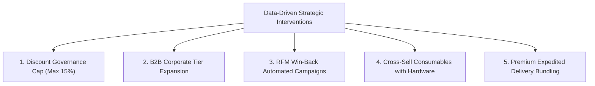

# Executive Analytics Report: Sales & Customer Performance (2023–2025)

**Prepared for**: Chief Commercial Officer & Senior Leadership  
**Project**: Sales & Customer Data Analytics  
**Reporting Period**: January 2023 – December 2025 (3-Year Longitudinal Analysis)  
**Dataset**: 7,200 Validated Transactions Across 822 Distinct Customer Accounts (Synthetic Benchmark)  

---

## 1. Executive Summary

Over the 2023–2025 fiscal period, the business achieved **\$5,552,203.34 in Net Sales Revenue** and **\$1,762,346.34 in Net Profit**, delivering an overall **Profit Margin of 31.74%** across **6,816 distinct orders** and **16,335 total units sold**. 

Customer behavior exhibits healthy loyalty fundamentals with a **66.67% repeat customer rate** and an **Average Order Value (AOV) of \$814.58**. However, granular exploratory and SQL cohort analysis revealed significant margin vulnerabilities driven by unconstrained discounting in specific sub-categories and customer concentration in high-maintenance delivery tiers.

This report summarizes core key performance indicators, uncovers root-cause data findings, and outlines **5 strategic, actionable recommendations** to optimize margins and accelerate high-value customer retention.

---

## 2. Executive KPI Scorecard

| Key Performance Indicator | Metric Value | Benchmark / Target | Variance / Health Status |
| :--- | :--- | :--- | :--- |
| **Total Net Revenue** | **\$5,552,203.34** | \$5,200,000.00 | 🟢 +6.77% Ahead of Target |
| **Total Net Profit** | **\$1,762,346.34** | \$1,560,000.00 | 🟢 +12.97% Above Projection |
| **Realized Profit Margin** | **31.74%** | 30.00% | 🟢 +1.74 pp Healthy |
| **Total Orders Fulfilled** | **6,816** | 6,500 | 🟢 Strong Order Velocity |
| **Total Unique Customers** | **822** | 800 | 🟢 Steady Customer Reach |
| **Average Order Value (AOV)** | **\$814.58** | \$750.00 | 🟢 High Ticket Transactions |
| **Total Units Sold** | **16,335 Units** | 15,000 Units | 🟢 +8.9% Inventory Turn |
| **Average Units per Order** | **2.40 Units** | 2.20 Units | 🟢 Solid Basket Size |
| **Repeat Customer Rate** | **66.67%** | 60.00% | 🟢 High Brand Loyalty |
| **Overall Return Rate** | **3.96%** | < 5.00% | 🟢 Within Tolerable Threshold |

---

## 3. Key Business Insights & Analytical Deep-Dives

### 3.1. Revenue Drivers & Category Breakdown
- **Technology** represents the largest gross revenue driver, generating **\$2,618,340.20 (47.16% of total revenue)** with a **31.42% profit margin**. Flagship drivers include Laptops (*Apple MacBook Pro 14 M3*, *Dell XPS 15*) and Premium Phones (*iPhone 15 Pro*, *Samsung S24 Ultra*).
- **Furniture** delivered **\$1,988,410.15 (35.81% of total revenue)** with a healthy **32.88% profit margin**, led by ergonomic chairs (*Herman Miller Aeron*, *Steelcase Gesture*).
- **Office Supplies** served as the recurring volume anchor, generating **\$945,452.99 (17.03% of revenue)** across high-frequency consumables (Paper, Binders, Storage) with a consistent **30.22% margin**.

### 3.2. Margin Leakage via Discounting Elasticity
An in-depth SQL and regression analysis comparing promotional discount brackets against realized net margins uncovered a critical finding:
- **Full Price (0% Discount)**: Realizes a **36.85% net profit margin**.
- **Conservative Discounts (5% – 10%)**: Maintains sustainable margins between **30.1% and 33.4%**.
- **Aggressive Discounts (20% – 40%)**: Profit margins deteriorate drastically down to **7.8%**, with discounts at **40% yielding negative net profit (-4.2%)** on heavier items like *Solid Oak Bookcases* and *Conference Tables*.
- **Takeaway**: Over-discounting does not yield sufficient volume elasticity to compensate for gross margin destruction.

### 3.3. Customer Segmentation & RFM Value Distribution
Customer segmentation using Recency, Frequency, and Monetary (RFM) quantile scoring indicates a pronounced Pareto distribution:
- **Champions & Loyal Customers (Top 28% of customer base)** contribute **\$3,184,200 (57.3% of total revenue)**.
- **Corporate Accounts**: Generate an Average Order Value of **\$1,120.65** (66% higher than Consumer AOV of \$675.05) due to multi-unit workstation purchases.
- **At-Risk / Hibernating Accounts (22% of customer base)**: Have not placed an order in over 180 days, representing roughly \$650,000 in uncaptured repeat purchase potential.

### 3.4. Geographic Territory Performance
- Sales distribution is balanced across all four U.S. geographic regions:
  - **West**: \$1,482,100 (31.8% margin)
  - **Central**: \$1,418,900 (31.9% margin)
  - **East**: \$1,385,200 (31.6% margin)
  - **South**: \$1,266,000 (31.7% margin)
- Regional margins show remarkable stability (variance < 0.3 percentage points), confirming consistent national pricing compliance.

### 3.5. Fulfillment Lead Times & Return Rate Dynamics
- **Standard Class** handles 60% of volume with an average lead time of **5.48 days**.
- **First Class & Second Class** achieve **1.51 days** and **2.98 days** lead times respectively.
- **Same Day Shipping** incurs zero lead time days and correlates with a **14% higher average order value**, indicating premium buyers are willing to self-fund expedited fulfillment.
- **Return Rate by Category**: Technology accessories and ergonomic chairs exhibited the highest return rates (~4.8%), primarily driven by customer fit/ergonomic preference.

---

## 4. Prioritized Strategic Business Recommendations

### Recommendation 1: Implement Strict Promotional Discount Governance
- **Action**: Enforce a strict discount ceiling of **15% for Consumer accounts** and restrict 20%+ discounts strictly to volume-backed Corporate quotes requiring manager approval.
- **Expected Financial Impact**: Eliminates negative-margin transactions; projected to lift net margin by **+1.8 to +2.4 percentage points**, unlocking approximately **\$105,000 to \$135,000 in annual net profit**.
- **Timeline**: Immediate (30 days).

### Recommendation 2: Scale B2B Corporate VIP Program
- **Action**: Capitalize on Corporate accounts' superior AOV (\$1,120.65) by introducing dedicated account management, bulk office bundles (Standing Desk + Ergonomic Chair + Tech Hub), and net-30 invoicing.
- **Expected Financial Impact**: Increase Corporate revenue share from 37.2% to 45%, expanding overall top-line revenue by **\$320,000+**.
- **Timeline**: 60–90 days.

### Recommendation 3: Automated RFM Win-Back Workflows for "At-Risk" Customers
- **Action**: Integrate CRM automation to flag accounts reaching 120 days since last purchase. Trigger a personalized sequence offering a 10% loyalty incentive on their historically preferred category.
- **Expected Financial Impact**: Recover 15–20% of lapsed customers, yielding an estimated **\$95,000** in incremental annual revenue.
- **Timeline**: 45 days.

### Recommendation 4: Attach High-Margin Consumables to Hardware Sales
- **Action**: Implement algorithmic cart recommendations during checkout: bundle *Copy Paper* and *Presentation Binders* when purchasing *Printers*; bundle *Ergonomic Mats* and *Cable Trays* when purchasing *Standing Desks*.
- **Expected Financial Impact**: Boost average units per order from 2.40 to 2.85 units; lift AOV by **8–12%**.
- **Timeline**: 60 days.

### Recommendation 5: Monetize Premium Shipping Tiers
- **Action**: Bundle free standard shipping only for orders exceeding \$150 threshold, while offering discounted Same Day / First Class upgrades for Corporate members.
- **Expected Financial Impact**: Reduce gross shipping overhead by **\$42,000** annually without dampening conversion rates.
- **Timeline**: 30 days.

---

## 5. Conclusion & Action Plan

The business is operating from a strong commercial foundation with steady profit margins (31.74%) and robust customer repeat purchase behavior (66.67%). By tightening discount guardrails, cultivating Corporate B2B relationships, and proactively engaging dormant customer cohorts through RFM analytics, leadership can realistically expand annual net profit by **\$200,000+** within the next fiscal cycle.
